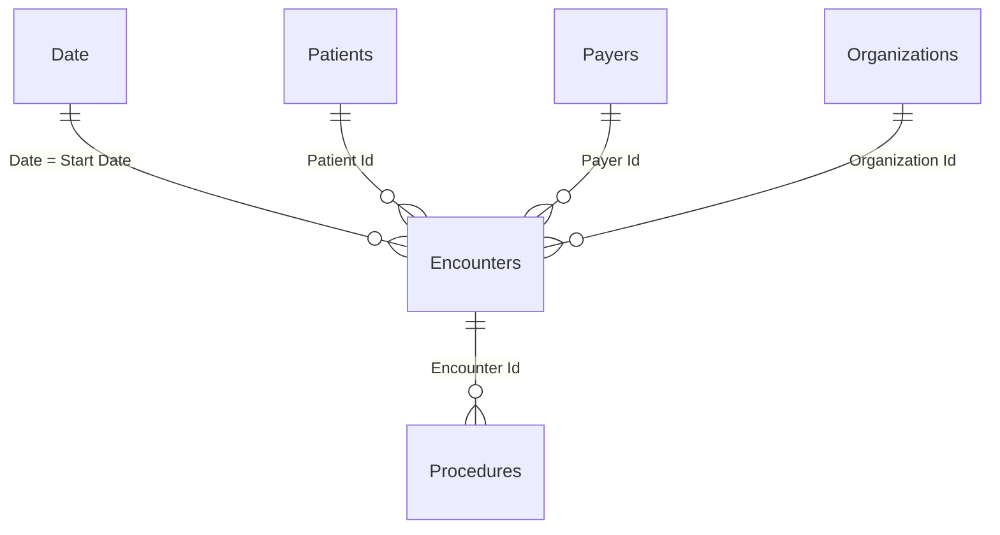

# Data & Approach

Five CSV extracts (encounters, procedures, payers, de-identified patients, organizations) are loaded into a Power BI star schema. Encounters sit at the center; procedures relate through Encounter Id, so the Year, Encounter Class and Payer slicers filter every visual, including procedure charts. All relationships are one-to-many and single-direction.

*Figure 1. Data model*

## Key Transformations (Power Query)

- Timestamps kept in UTC; SNOMED codes typed as text.
- Added Duration Hours, Over 24 Hours, Zero Coverage, Uncovered Amount and a 30-day return flag.
- No rows were removed and no values imputed.
- Every KPI was independently recalculated in Python and SQL (see [Validation](06_validation_evidence.md)).
